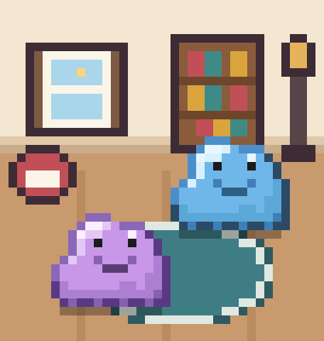

# opencode-ditto-room

A pixel-art Ditto room for the OpenCode TUI session sidebar. Every active direct child session gets a pink Ditto. When fewer than two agents are running, shiny blue companion Dittos keep the room populated.



Status: v1.0.0, tested with OpenCode 2.2.4. Two source files, no build step, no npm dependencies at runtime.

## What it does

- Draws a full-bleed, 38-cell-wide pixel-art room at the bottom of the session sidebar, directly above the built-in cwd and branch line.
- Shows one pink Ditto per direct child session that is active right now. A Ditto pops in when its child starts and pops out when it ends.
- Keeps a minimum of two Dittos on screen: 0 active agents gives 2 blue companions, 1 gives 1 pink plus 1 blue, 2 or more gives pink only.
- Draws at most 8 Dittos and queues the rest, shown as a `+N` badge.
- Animates solo behaviour (wander, visit, dance, jump, look around, emote, nap), chats between Dittos, speech bubbles, foot shadows and a few ambient pixels.
- Uses depth-aware overlap: Dittos at different floor depths may pass behind each other, while Dittos on the same plane keep their distance.
- Reads only local session state. It makes no network requests and writes no state files.

## Requirements

- OpenCode 2.2.4 is the tested version. The TUI plugin data and slot APIs are not stable across OpenCode releases, so another version may need code changes.
- A terminal at least 28 rows tall. The room is hidden below 28 rows. The default OpenCode layout also needs roughly 122 columns or more, because the session sidebar is 42 cells wide and the room is 38 cells wide.
- A terminal with 24-bit colour support is recommended. The art uses `#rrggbb` values directly and does not read the OpenCode theme.
- Node.js 22.18 or newer only for the test suite. OpenCode loads the TypeScript sources itself, so Node is not needed to use the plugin.

## Install

Find the OpenCode config directory (the one containing `cli.json`):

```bash
opencode debug paths
```

Clone the repository and copy both plugin files into a new directory under `tui-plugins/`:

```bash
CONFIG="$(opencode debug paths | awk '$1 == "config" { print $2 }')"
git clone https://github.com/ch3ngo/opencode-ditto-room.git
mkdir -p "$CONFIG/tui-plugins/ditto-room"
cp opencode-ditto-room/tui.tsx opencode-ditto-room/art.ts \
  "$CONFIG/tui-plugins/ditto-room/"
```

Add the plugin to the `plugins` array in `cli.json` inside that config directory. If the file already lists other plugins, add this one string to the existing array and leave the other entries alone:

```json
{
  "$schema": "https://opencode.ai/v2/cli.json",
  "plugins": [
    "./tui-plugins/ditto-room"
  ]
}
```

Restart the OpenCode TUI. The room appears at the bottom of the session sidebar.

To confirm that it loaded:

```bash
opencode plugin list
cat /tmp/opencode-ditto-room.log
```

`plugin list` should show the directory as a local plugin, and the log should contain `slot placement:` and `art loaded v10`.

### Update

Copy both files together. An engine and its art file are one pair:

```bash
cd opencode-ditto-room
git pull
CONFIG="$(opencode debug paths | awk '$1 == "config" { print $2 }')"
cp tui.tsx art.ts "$CONFIG/tui-plugins/ditto-room/"
```

Restart the TUI. Do not mix a `tui.tsx` from one version with an `art.ts` from another.

### Uninstall

Remove `"./tui-plugins/ditto-room"` from the `plugins` array in `cli.json`, delete the directory, and restart:

```bash
CONFIG="$(opencode debug paths | awk '$1 == "config" { print $2 }')"
rm -r "$CONFIG/tui-plugins/ditto-room"
rm -f /tmp/opencode-ditto-room.log
```

## Configuration

Set these environment variables before starting the TUI:

| Variable | Default | Effect |
|---|---|---|
| `OC_DITTO_DEMO` | off | Integer 1 to 12. Ignores real session data and animates N fake agent Dittos through the normal spawn and queue logic, plus the companions the minimum rule requires. Useful for previewing behaviour without starting subagents. |
| `OC_DITTO_MIN_HEIGHT` | `28` | Hides the room when `process.stdout.rows` is below this value. Must be an integer from 0 to 1000. Values below 28 have no practical effect because the room cannot render below 28 terminal rows. |
| `OC_DITTO_AMBIENT` | on | `0` stops the ambient object pixels. Any other value, or leaving it unset, keeps them on. |
| `OC_DITTO_ALWAYS` | on | Compatibility flag from an older build. `0` used to hide an empty room. With the minimum population the room is never empty, so the flag is effectively inert; any other value or unset keeps the current behaviour. |

Examples:

```bash
OC_DITTO_DEMO=2 opencode
OC_DITTO_AMBIENT=0 opencode
```

There is no `OC_DITTO_ROOM_ROWS`. The room height is derived from the terminal on every resize.

## Customization

The visual scene is data in `art.ts`. Behaviour constants are near the top of `tui.tsx`. There is no build step: edit either file and restart the TUI. Keep both files in the same directory.

### Colours

`PALETTE` in `art.ts` maps one character to one `#rrggbb` colour. Change a value to recolour every pixel that uses that key. `.` is not a palette key and means transparent.

Ditto body colours use the same frames. `DITTO_COLORS.agent` is empty, so pink Dittos use `PALETTE`. `DITTO_COLORS.companion` overrides the body keys with blue for companions. Missing keys fall back to `PALETTE`, which is why the eyes and tongue are shared.

### Room and background

The background is built from:

| Export | Meaning |
|---|---|
| `ROOM_W` | Room width in pixels. One pixel is one cell wide and half a cell tall. Currently 38. |
| `WALL_COLOR` | Palette key for the wall. |
| `BASEBOARD` | Rows drawn at the bottom of the wall, top row first. |
| `FLOOR_COLOR`, `FLOOR_SEAM_COLOR`, `FLOOR_SEAMS`, `FLOOR_SEAM_FROM` | Floor colour, plank seam colour, seam columns and how many rows below the floor top the seams start. |
| `OBJECTS` | Floor-anchored furniture, painted back to front. Each entry has `{ name, x, bottom, from?, rows }`. `bottom` is the offset of the object's last row from the floor top, or from the deepest usable floor row when `from` is `"bottom"`. Rows are bottom aligned and `.` is transparent. |

Keep every object inside `ROOM_W`. The smallest supported room has a 14-pixel wall, so wall props taller than that will clip. The five objects currently ship with the room: window, bookcase, floor lamp, dog bed and rug. You can edit their rows, move them with `x` and `bottom`, remove them, or add new entries.

### Ditto frames and sizes

`DITTO_SETS` is a list ordered from the back of the floor to the front. Each set has `w`, `h` and nine frames: `idle`, `squash`, `blink`, `happy`, `sad`, `laugh`, `wobbleL`, `wobbleR`, `stretch`. Every frame in a set must have the same width and height, with `h` rows of `w` characters, bottom aligned.

The current art ships one 14 x 11 set. The engine reads `w` and `h` from the set, so adding another set is supported by the renderer and the depth band logic, but it is an advanced change: positions, collision boxes, chat spacing and bubbles all use the set dimensions. There is no supported setting for per-session sprite size.

### Points of interest and ambient pixels

- `POIS` lists the places a lone Ditto may visit: window (`sparkle`), lamp (`note`) and rug (`zzz`). `cx` is the horizontal centre, `at` is `"back"` (floor top plus offset) or `"front"` (last usable feet row minus offset), and `emote` must be one of `EMOTE_NAMES`. Every point must be a legal standing spot at every supported height.
- `ANIM` lists ambient pixels as `{ x, dy, frames, every }`. `dy` is relative to the floor top, `frames` are palette keys, and `every` is the number of 600 ms ambient ticks per step. The first frame must match the pixel already drawn by the object underneath, so step 0 is the plain room.

### Disable the blue companions

There is no environment variable for this in v1.0.0. It is a one-line source edit in `tui.tsx`:

```ts
export const companionTarget = (agents: number) => 0
```

Restart the TUI. With no active agents the room is then empty, but it stays visible because `OC_DITTO_ALWAYS` defaults to on, and the ambient pixels keep moving. Agents still appear normally.

### Behaviour knobs

These constants in `tui.tsx` control the runtime:

| Constant | Current value | Effect |
|---|---|---|
| `MAX_DITTOS` | 8 | Maximum number drawn at once. Extra Dittos wait in the queue and appear in the `+N` badge. |
| `TICK_MS` | 200 | Ditto animation tick. |
| `AMBIENT_MS` | 600 | Ambient pixel tick. |
| `SAME_DEPTH_PX` | 4 | Feet rows within this distance are treated as the same plane and may not overlap. |
| `CHAT_PAD`, `CHAT_DY`, `CHAT_GAP` | 6, 8, 2 | Chat reach and spacing. |
| `pickAction` weights | wander 35, visit 20, lookaround 15, dance 10, jump 10, emote 5, nap 5 | Solo behaviour probabilities. The nap weight is only added after 3 actions and with fewer than 3 Dittos drawn. |

## Roadmap

Planned for a later release, not implemented in v1.0.0:

- A supported companion toggle, for example `OC_DITTO_COMPANIONS=0`, instead of the source edit above.
- Multiple built-in scenes and a way to choose one.
- A random scene per OpenCode session start.

The current release has exactly one scene and one 14 x 11 Ditto shape. Background changes today are source edits to `art.ts`, not settings.

## Compatibility and limitations

- Tested with OpenCode 2.2.4. The plugin depends on the TUI `Plugin.define`, `context.data`, `context.ui.slot` and session family/status APIs. A future OpenCode release may rename or change them. The plugin catches read failures and renders nothing rather than breaking the sidebar, but it cannot paper over a removed API.
- The hard minimum is 28 terminal rows. `OC_DITTO_MIN_HEIGHT` can hide the room earlier, but it cannot make it render below 28 rows.
- The room is designed for the default 42-cell sidebar. Terminals narrower than roughly 122 columns can clip the sidebar or the room.
- One scene, one sprite size, at most 8 Dittos drawn. Everything beyond the cap is queued, not dropped.
- Spawn and despawn depend on real active direct child sessions. Real lifecycle testing needs a model call and is not covered by the offline test suite.
- In headless testing, a session with no live assistant activity still showed OpenCode's large empty-state sidebar graphic over the sidebar plugin area, hiding the room. The plugin loaded and composed its frames during that time. If the room is not visible right after install, open or continue a session with conversation content and restart the TUI. Normal active sessions are the intended case.
- The rendering was verified from tmux captures. Native terminal colours, light terminal themes and very long sessions with many agents have not been exhaustively tested.
- The log at `/tmp/opencode-ditto-room.log` is appended to and is not rotated. It records load and unload, slot placement, art version, room height changes, population counts and error messages. It never records session ids, prompts or task text.

## Verification

Run the dependency-free checks:

```bash
node --test tests/*.test.mjs
```

The tests validate the art contract: palette keys, row widths, frame names and sizes, object bounds, emote, bubble and glyph sizes, point-of-interest bounds, ambient frames, the relative import in `tui.tsx`, and the absence of private paths and attribution trailers in shipped text files. They also confirm the MIT license and the PNG preview.

Manual TUI verification for v1.0.0 was done on 02/11/2026 with OpenCode 2.2.4 in tmux at terminal sizes from 140x28 to 140x44 and 122x34, using `OC_DITTO_DEMO` 1, 2 and 8, a childless session for 0 agents, and ambient on and off. The checked points were:

- 15 to 20 room rows across 28 to 44 terminal rows, with the floor depth preserved per tier.
- 0 unexplained pixels and no prop clipping at every height.
- Population 0 gives 2 blue, 1 gives 1 pink plus 1 blue, 2 gives pink only.
- Demo 8 draws 6 plus 2 queued at 34 rows and 8 at 40 rows.
- A 40 to 34 to 44 to 36 to 35 to 28 to 40 resize run with no `overlap fixed` entries.

Not verified: real spawn and despawn on a live subagent, native terminal colours outside tmux, and the 4-pixel depth threshold over a long real session.

## Project layout

```
art.ts                 art data, no imports or functions
tui.tsx                plugin, renderer, movement and session tracking
tests/art.test.mjs     art contract checks
tests/repo.test.mjs    license, privacy and preview checks
preview.png            static render of the art at 20 rows
LICENSE                MIT license for the code
CHANGELOG.md           release history
```

## Ditto and Pokémon

Ditto is a Pokémon character. Pokémon and Pokémon character names are trademarks of Nintendo, Creatures Inc. and GAME FREAK inc. Ditto and all related character rights belong to their respective owners.

This is an unofficial, unaffiliated, noncommercial fan project. The author does not sell it and earns nothing from it. The MIT license covers the original plugin code only. It does not grant any rights to Ditto, Pokémon, any other character, or any trademark. The noncommercial intent stated here is not a permission from the rights holders and does not relicense any third-party material.

## License

The original code in this repository is released under the MIT License. See [LICENSE](LICENSE). The Ditto and Pokémon notice above applies to the character and trademark material.
