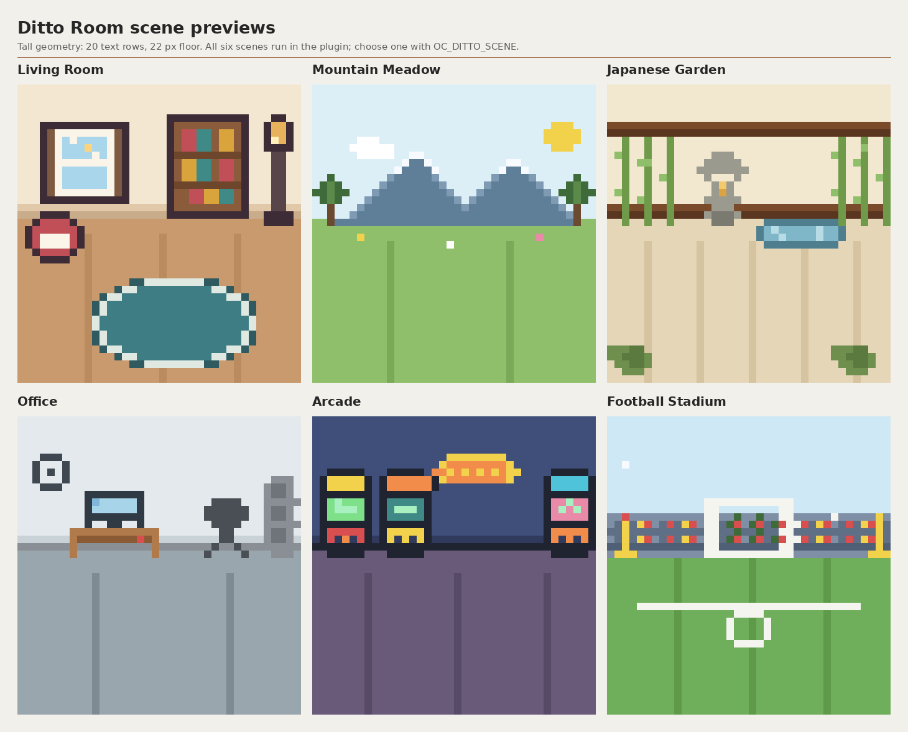
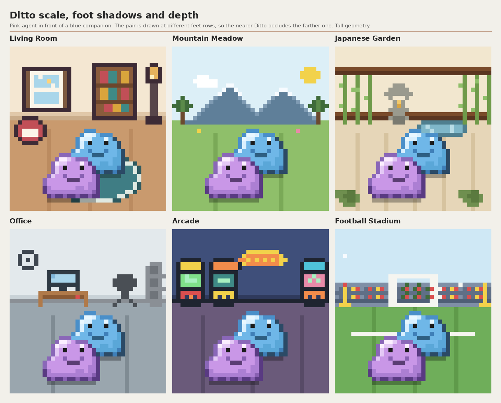

# opencode-ditto-room

A pixel-art Ditto room for the OpenCode TUI session sidebar. Every active direct child session gets a pink Ditto; with companions enabled (the default) and fewer than two agents running, shiny blue companion Dittos keep the room populated. The room uses one of six flat scenes, chosen once per startup. Three source files, no build step, no runtime dependencies.


## Requirements
- OpenCode 2.2.4 is the tested version; the TUI plugin APIs are not stable across releases.
- A terminal of at least 28 rows and roughly 122 columns, with 24-bit colour: the art uses `#rrggbb` values and does not read the OpenCode theme.
- Node.js 22.18 or newer only for the test suite and preview tools.

## Install
Copy all three plugin files into a new directory under `tui-plugins/` in the OpenCode config directory (the one containing `cli.json`, printed by `opencode debug paths`):

```bash
CONFIG="$(opencode debug paths | awk '$1 == "config" { print $2 }')"
git clone https://github.com/ch3ngo/opencode-ditto-room.git
mkdir -p "$CONFIG/tui-plugins/ditto-room"
cp opencode-ditto-room/tui.tsx opencode-ditto-room/art.ts opencode-ditto-room/scenes.ts "$CONFIG/tui-plugins/ditto-room/"
```

Add the plugin to the `plugins` array in `cli.json`; if other plugins are listed, add this string to the existing array and leave the rest alone:

```json
{
  "$schema": "https://opencode.ai/v2/cli.json",
  "plugins": ["./tui-plugins/ditto-room"]
}
```

Restart the TUI. The room appears at the bottom of the session sidebar, and `opencode plugin list` shows the directory as a local plugin.

### Update
Copy all three files together after pulling: the engine, art and scene data are one set, and mixing versions is unsupported.

```bash
cd opencode-ditto-room && git pull
CONFIG="$(opencode debug paths | awk '$1 == "config" { print $2 }')"
cp tui.tsx art.ts scenes.ts "$CONFIG/tui-plugins/ditto-room/"
```

### Uninstall
Remove `"./tui-plugins/ditto-room"` from the `plugins` array, then:

```bash
CONFIG="$(opencode debug paths | awk '$1 == "config" { print $2 }')"
rm -r "$CONFIG/tui-plugins/ditto-room" /tmp/opencode-ditto-room.log
```

## Configuration
Set these before starting the TUI; they are read at startup.

| Variable | Default | Effect |
|---|---|---|
| `OC_DITTO_SCENE` | `random` | Stable scene ID pins the scene; unset or `random` picks one per start; invalid falls back to Living Room. |
| `OC_DITTO_DEMO` | off | Integer 1 to 12: animate that many fake agents instead of real session data. |
| `OC_DITTO_COMPANIONS` | on | `0` removes the blue filler companions, so only real active agents appear. |
| `OC_DITTO_MIN_HEIGHT` | `28` | Hides the room when the terminal has fewer rows than this. |
| `OC_DITTO_AMBIENT` | on | `0` stops the ambient pixel animation of the selected scene. |
| `OC_DITTO_ALWAYS` | on | Compatibility flag for empty-room visibility; `0` hides the room when no Ditto would be drawn. |

## Scenes
| ID | Scene |
|---|---|
| `living-room` | Living Room |
| `mountain-meadow` | Mountain Meadow |
| `japanese-garden` | Japanese Garden |
| `office` | Office |
| `arcade` | Arcade |
| `football-stadium` | Football Stadium |





## Limitations
- Tested only with OpenCode 2.2.4. The plugin depends on TUI APIs that may change, and a removed API cannot be papered over.
- Needs at least 28 terminal rows and roughly 122 columns; narrower terminals can clip the sidebar or the room.
- The scene is chosen at startup only. There is no live switch and no persistence of the random choice.
- In headless testing, a session with no live assistant activity showed OpenCode's empty-state sidebar graphic over the plugin area, hiding the room.
- Real subagent spawn and despawn has not been tested against a live model call; the offline suite does not cover it.

## Tests
Run `node --test tests/*.test.mjs`.

## Ditto and Pokémon
Ditto is a Pokémon character. Pokémon and Pokémon character names are trademarks of Nintendo, Creatures Inc. and GAME FREAK inc., and all related character rights belong to their respective owners. This is an unofficial, unaffiliated, noncommercial fan project. The MIT license covers the original plugin code only and grants no rights to Ditto, Pokémon, any other character, or any trademark.

## License
The original code is released under the MIT License. See [LICENSE](LICENSE).
